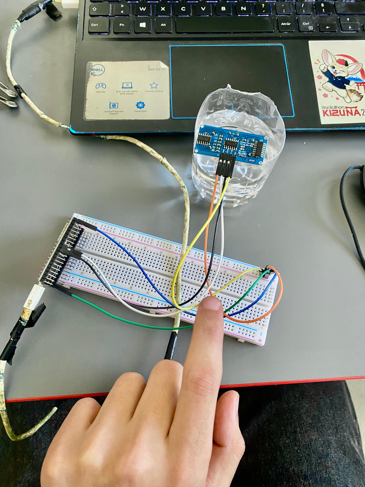

# QATRA — Prototype matériel LoRa et mesure du niveau d'eau

Ce dossier rassemble des essais matériels complémentaires du projet QATRA. Il présente deux démonstrateurs indépendants : une carte ESP32 LoRa32 utilisée comme récepteur LoRa avec écran OLED, et un montage ESP32 qui estime le niveau d'eau d'un réservoir à l'aide d'un capteur ultrasonique.

Ces essais illustrent des briques matérielles du projet. Ils ne constituent pas à eux seuls un système d'irrigation intégré et ne remplacent ni la simulation Arduino Uno de `main`, ni la solution ESP32/MQTT de la branche `solution-iot`.

## Galerie du prototype LoRa

Les deux photos sont affichées côte à côte pour comparer le démarrage de la passerelle et l'état de la carte pendant le test.

<table width="100%">
  <tr>
    <td align="center" width="50%">
      
       <strong>Démarrage — passerelle en écoute</strong>
    </td>
    <td align="center" width="50%">
      
       <strong>Test — carte LoRa et écran OLED</strong>
    </td>
  </tr>
</table>

## Mesure ultrasonique du réservoir

Cette photo montre le montage expérimental du capteur de distance utilisé pour estimer la hauteur d'eau.

  

<em>Montage de test du capteur ultrasonique au-dessus du réservoir.</em>

## Fonctionnement

### Récepteur LoRa — `LilyGOTTGOLoRa32`

Le sketch `LilyGOTTGOLoRa32/LilyGOTTGOLoRa32.ino` configure une carte TTGO LoRa32/T3 avec radio SX1276. Il écoute les messages LoRa, affiche l'état sur l'écran OLED 128 × 64 et écrit les messages reçus ainsi que le RSSI sur le port série.

Configuration radio définie dans le code :

- fréquence : **868,8 MHz** ;
- bande passante : **125 kHz** ;
- facteur d'étalement : **SF7** ;
- taux de codage : **4/5** ;
- mot de synchronisation : `0x12` ;
- puissance d'émission configurée : **14 dBm**.

Le sketch présent dans ce dossier est un **récepteur** ; le code d'un émetteur correspondant n'y est pas inclus. Pour recevoir les paquets, l'émetteur doit utiliser des paramètres LoRa compatibles.

### Estimation du niveau d'eau — `UltrasonEsp32`

Le sketch `UltrasonEsp32/UltrasonEsp32.ino` mesure la distance entre le capteur et la surface de l'eau, puis calcule une hauteur et un pourcentage de remplissage à partir d'une hauteur de réservoir configurée à **9 cm**.

Pour limiter les lectures instables, le programme prend jusqu'à sept mesures, conserve celles comprises entre **2 et 9 cm**, puis calcule leur médiane. Il signale une erreur s'il reste moins de trois mesures valides. Les résultats et un message de niveau (faible, normal ou presque plein) sont affichés sur le moniteur série.

## Fichiers

| Chemin | Rôle |
| --- | --- |
| `LilyGOTTGOLoRa32/LilyGOTTGOLoRa32.ino` | Initialisation LoRa et OLED, réception des paquets et affichage du RSSI |
| `UltrasonEsp32/UltrasonEsp32.ino` | Mesure ultrasonique, filtrage médian et estimation du remplissage |
| `demarrage LoRa.jpeg` | Photo du démarrage de la passerelle |
| `test LoRa.jpeg` | Photo du test de la carte LoRa |
| `UltrasonEsp32.jpeg` | Photo du montage ultrasonique |

## Mise en route

1. Ouvrir le sketch voulu dans l'IDE Arduino et sélectionner la carte ESP32 adaptée au matériel.
2. Pour `LilyGOTTGOLoRa32`, installer **RadioLib**, **Adafruit GFX Library** et **Adafruit SSD1306**. Vérifier l'adresse I²C de l'OLED (`0x3C`) et le brochage de la variante exacte de la carte.
3. Vérifier que l'émetteur LoRa utilise des paramètres compatibles avec le récepteur. Respecter les fréquences et puissances autorisées par la réglementation locale.
4. Pour `UltrasonEsp32`, vérifier le câblage `TRIG_PIN`/`ECHO_PIN` et adapter `TANK_HEIGHT`, `MIN_DISTANCE` et `MAX_DISTANCE` aux dimensions réelles du réservoir.
5. Ouvrir le moniteur série à **115200 bauds** pour observer les mesures et les messages de diagnostic.

## Limites du prototype

Les valeurs de hauteur et les seuils de remplissage doivent être calibrés sur le réservoir et le capteur réellement utilisés. Les photos montrent des montages d'essai ; elles ne valident pas encore une installation agricole complète, une autonomie LoRa de terrain ou des économies d'eau. La mesure ultrasonique de ce sketch est envoyée au port série ; elle n'est pas reliée ici à MQTT ni à la commande de la pompe.
