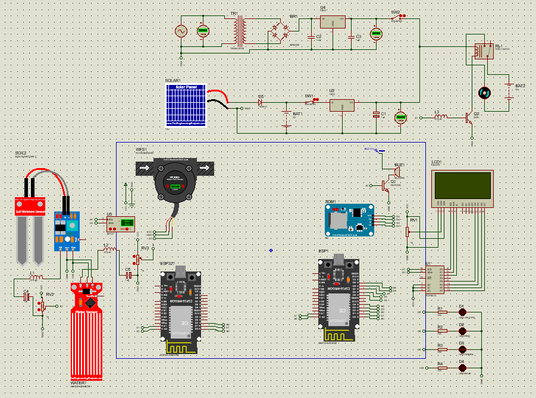
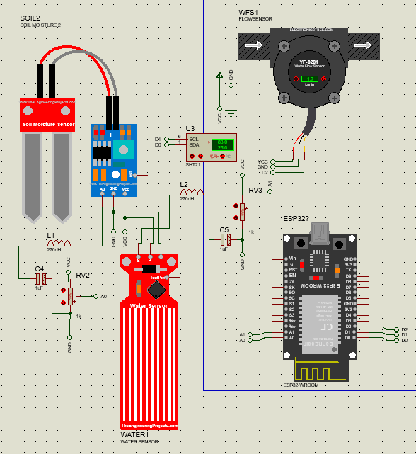
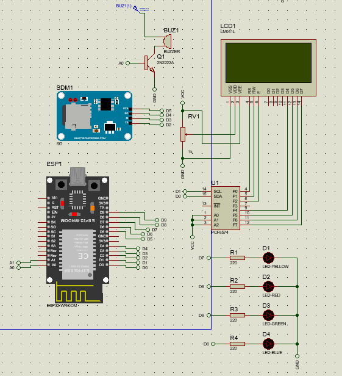
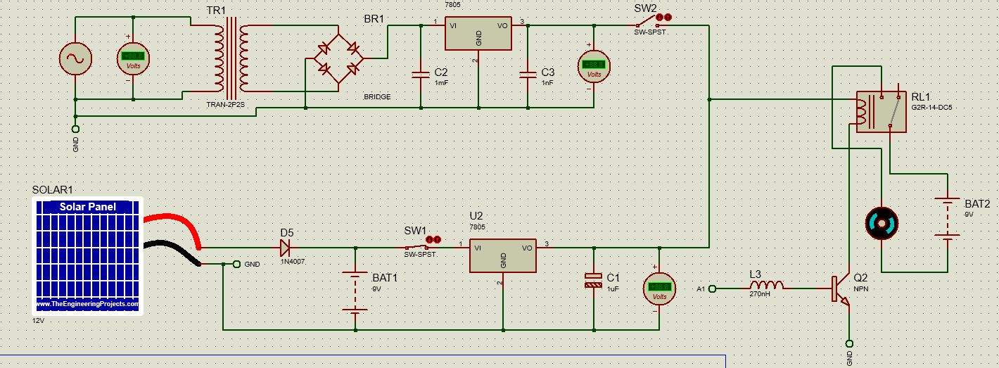

# QATRA — Solution IoT avec ESP32 et MQTT

Cette branche présente la suite connectée du prototype QATRA : deux cartes **ESP32** échangent les données de la parcelle par **MQTT**. L'architecture reprend les mesures de la simulation Arduino Uno et les relie à une unité de commande pouvant publier l'état du système et recevoir une commande de test.

> Les valeurs Wi-Fi du code sont des placeholders. Le dépôt utilise le broker public `broker.hivemq.com` sur le port MQTT non chiffré `1883` : cette configuration sert aux essais et ne convient pas à un déploiement de production.

## Vue générale



*La simulation regroupe les capteurs, les deux ESP32, l'affichage, les indicateurs, la pompe et un bloc d'alimentation étudié pour le montage.*

## Architecture

### ESP1 — acquisition sur la parcelle

`ESP1/ESP1.ino` lit les capteurs et publie leurs mesures :

- **SHT21** : température et humidité de l'air par I²C ;
- **capteur capacitif** : humidité du sol par entrée analogique ;
- **capteur de niveau** : niveau du réservoir par entrée analogique ;
- **YF-S201** : débit à partir des impulsions du débitmètre.

Les valeurs sont mises en forme dans une trame `T:...,H:...,S:...,W:...,F:...` et publiées toutes les deux secondes sur MQTT quand le broker est joignable. Une copie est également envoyée sur le port série pour le débogage.

### ESP2 — supervision locale et commande

`ESP2/ESP2.ino` s'abonne aux mesures et à l'état de disponibilité d'ESP1. Il valide les trames et leurs plages de valeurs, calcule le volume distribué, met à jour l'écran LCD, les LEDs et le buzzer, et enregistre les données dans `QATRA.CSV` sur carte SD.

L'ESP2 pilote la pompe par l'intermédiaire du transistor et du relais du montage. Les protections restent dans le contrôleur local : la pompe dépend de données fraîches, d'un réservoir assez rempli et de seuils de sol, débit et durée. Une perte de données déclenche le délai de sécurité configuré dans le code. Les commandes distantes de test ne remplacent pas ces protections.

<table>
  <tr>
    <td align="center" width="50%">
      
      <br><strong>ESP1 — Capteurs et acquisition</strong>
    </td>
    <td align="center" width="50%">
      
      <br><strong>ESP2 — Supervision et commande</strong>
    </td>
  </tr>
</table>

## Échanges MQTT

Les sujets sont construits depuis `TOPIC_BASE`, défini dans les deux sketches. La valeur initiale est `qatra/solitech42` ; configurez une base identique sur ESP1 et ESP2 et choisissez un identifiant unique pour vos essais.

| Sujet | Sens | Contenu |
| --- | --- | --- |
| `qatra/solitech42/capteurs` | ESP1 → ESP2 | Trame texte `T`, `H`, `S`, `W`, `F` |
| `qatra/solitech42/esp1/statut` | ESP1 → broker | Disponibilité `online` / `offline` (message retained / Last Will) |
| `qatra/solitech42/etat` | ESP2 → broker | État JSON : statut, pompe, mesures, débit et volume |
| `qatra/solitech42/cmd` | client → ESP2 | Commande de test `FORCE:1` ou `FORCE:0` |

L'ESP2 publie son état lors d'un changement de statut et périodiquement. La commande `FORCE` sert à tester la pompe ; elle peut contourner le seuil d'humidité, mais pas les contrôles de données, de réservoir, de débit anormal ou de durée maximale.

### Exemple de trame de mesure

```text
T:24.8,H:55.0,S:28,W:72,F:1.4
```

Les champs correspondent à la température en °C, l'humidité de l'air en %, l'humidité du sol en %, le niveau du réservoir en % et le débit en L/min.

## Seuils et comportements de sécurité

Les valeurs ci-dessous sont celles du sketch ESP2 ; elles sont modifiables dans le code et doivent être calibrées pour les capteurs et l'installation réels.

- démarrage automatique si le sol est sous **30 %** et le réservoir au moins à **25 %** ;
- arrêt à **45 %** d'humidité du sol, ou sous **10 %** de niveau d'eau ;
- durée maximale de marche : **60 s**, suivie d'un repos minimal de **30 s** ;
- arrêt sur débit excessif ; défaut « pompe sans débit » après le délai et le nombre de mesures configurés ;
- détection d'une perte de données après **6 s** ;
- enregistrement CSV sur carte SD et signalement local des alertes.

## Schéma d'alimentation

Le bloc ci-dessous est une vue complémentaire de l'alimentation solaire et de sa régulation ; il doit être dimensionné et validé pour le matériel choisi.

<p align="center">
  
</p>
<p align="center"><em>Alimentation solaire, batterie, redressement et régulation — schéma Proteus.</em></p>

## Configuration et démarrage

1. Ouvrir `Qatra.pdsprj` dans Proteus pour examiner le montage de cette branche.
2. Ouvrir séparément `ESP1/ESP1.ino` et `ESP2/ESP2.ino` dans l'IDE Arduino avec le cœur de cartes ESP32 installé.
3. Installer **PubSubClient** ; ESP2 utilise aussi **LiquidCrystal_I2C**. `WiFi`, `Wire`, `SPI` et `SD` proviennent du cœur Arduino/ESP32.
4. Remplacer localement `VOTRE_WIFI` et `VOTRE_MOT_DE_PASSE` par les paramètres de l'environnement de test. Ne publiez pas de vrais identifiants dans le dépôt.
5. Vérifier le broker et régler la même valeur de `TOPIC_BASE` sur les deux cartes.
6. Vérifier le brochage défini par les alias `P_Dx` et `P_Ax` avec le modèle exact de carte ESP32 et le câblage Proteus avant le téléversement.
7. Observer les publications avec un client MQTT abonné aux sujets du tableau ; contrôler l'affichage, les indicateurs, la pompe et le journal SD pendant les essais.

## Broker public : précautions

Le broker par défaut est public, sans authentification dans ces sketches, et le port `1883` n'apporte pas de chiffrement. Les sujets et messages peuvent donc être vus ou perturbés par d'autres utilisateurs, et le sujet de démonstration peut entrer en collision avec une autre installation. Pour un déploiement réel, utiliser un broker privé avec authentification, chiffrement TLS, contrôle d'accès par sujet et identifiants conservés hors du dépôt.

## Fichiers de cette version

| Chemin | Rôle |
| --- | --- |
| `Qatra.pdsprj` | Montage Proteus avec ESP32 |
| `ESP1/ESP1.ino` | Acquisition et publication des mesures |
| `ESP2/ESP2.ino` | Réception MQTT, supervision, sécurité et commande |
| `Montage.PNG` | Vue d'ensemble du montage |
| `image_esp1.PNG` | Partie capteurs et ESP1 |
| `image_esp2.PNG` | Partie ESP2 et périphériques |
| `alimention.PNG` | Schéma complémentaire d'alimentation |

La version Arduino Uno antérieure et sa documentation restent disponibles sur la [branche principale `main`](https://github.com/Bejaoui-Fedi/QATRA/tree/main).
