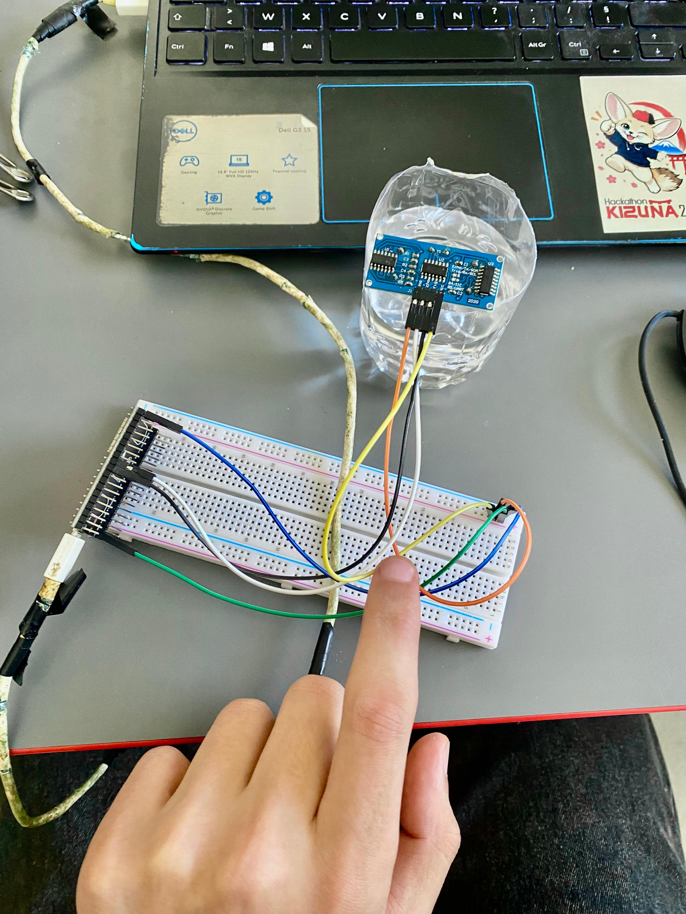

# QATRA — Prototype matériel

Bienvenue dans la branche **`prototype`**. Elle regroupe les essais matériels LoRa et ultrasonique de QATRA. Cette page d'accueil est propre à cette branche ; le README complet du dossier se trouve dans [`Prototype/README.md`](Prototype/README.md).

## Essais LoRa

Le sketch TTGO LoRa32/SX1276 reçoit des messages LoRa, affiche l'état sur l'OLED et transmet les messages reçus ainsi que le RSSI au moniteur série. Le code inclus est celui du récepteur.

| Démarrage — passerelle en écoute | Test — carte LoRa et écran OLED |
| :---: | :---: |
|  |  |

## Mesure du niveau d'eau

Un second sketch ESP32 estime le niveau du réservoir à partir de la distance mesurée par ultrasons. Il filtre plusieurs lectures et affiche le résultat sur le moniteur série.

| Montage ultrasonique du réservoir |
| :---: |
|  |

Les essais sont indépendants : la mesure ultrasonique n'est pas reliée ici au LoRa, à MQTT ni à la commande de la pompe. Pour les détails, les paramètres, les fichiers et les limites, consultez le [README du dossier Prototype](Prototype/README.md).
